<!--
  Profile README for Siddharthpandey20.
  Every card in assets/ is a hand-built SVG animated with SMIL (no JavaScript), generated by scripts/build_assets.py.
  <picture> sources switch between dark/light themes and a phone layout below 600px.
  The contribution snake is regenerated daily by .github/workflows/snake.yml into the `output` branch.
-->

<picture>
  <source media="(max-width: 600px) and (prefers-color-scheme: dark)" srcset="assets/hero/hero-dark-m.svg">
  <source media="(max-width: 600px)" srcset="assets/hero/hero-light-m.svg">
  <source media="(prefers-color-scheme: dark)" srcset="assets/hero/hero-dark.svg">
  
</picture>

<picture>
  <source media="(prefers-color-scheme: dark)" srcset="https://readme-typing-svg.demolab.com?font=JetBrains+Mono&weight=500&size=17&duration=2600&pause=1100&color=2DD4BF&center=true&vCenter=true&width=760&height=34&lines=Backends%20that%20hold%20up%3A%20queues%2C%20retries%2C%20rate%20limits%2C%20tests;Hybrid%20retrieval%3A%20BM25%20%2B%20dense%20vectors%20%2B%20rank%20fusion;Multi-agent%20systems%20where%20humans%20make%20the%20final%20call;82%20PRs%20merged%20into%20a%20production%20AI%20interview%20platform;First%20author%20%C2%B7%20MMCITRE%202025%20%28Springer%29%20%C2%B7%20NCA%202026">
  
</picture>

<a href="#about"><b>About</b></a> &nbsp;·&nbsp; <a href="#-experience"><b>Experience</b></a> &nbsp;·&nbsp; <a href="#featured-projects"><b>Projects</b></a> &nbsp;·&nbsp; <a href="#research--publications"><b>Research</b></a> &nbsp;·&nbsp; <a href="#tech-stack"><b>Stack</b></a> &nbsp;·&nbsp; <a href="#activity"><b>Activity</b></a>

## About

I'm a fifth-semester Computer Science student at **IIIT Naya Raipur** with a CGPA of **9.74**, and an AI Engineering Intern at **Hiring Bazaar**, where I've merged **82 pull requests** into a production AI interview platform. I build backend systems (task pipelines, multi-tenant APIs, access control) and the retrieval and LLM layers that run on top of them. I'm first author on **two accepted papers**, with a third, **CausalLine**, in preparation.

<picture>
  <source media="(max-width: 600px)" srcset="assets/terminal/neofetch-m.svg">
  
</picture>

## 💼 Experience

<table>
<tr>
<td valign="top">

### 🤖 Hiring Bazaar — AI Engineering Intern
**Mar 2026 – Present** · Remote

- **82 pull requests merged** into the platform's production codebase (private GitHub organization)
- Shipped a **voice recruiter copilot** (STT/TTS + LLM intent parsing) over 1,000+ profiles → manual screening **−60%**
- Restructured async interview pipelines (**BullMQ + TypeScript**) → response latency **−40%**
- Token-usage guardrails + prompt caching → LLM API cost **−30%**
- Built LLM-orchestration microservices in **FastAPI** + **Express.js**, with **Judge0** for live code evaluation

</td>
</tr>
</table>

## Featured Projects

<i>Systems I designed, built and measured. Each card links to its repository; open a deep-dive for the engineering details.</i>

<a href="https://github.com/Siddharthpandey20/ExamAI">
<picture>
  <source media="(max-width: 600px) and (prefers-color-scheme: dark)" srcset="assets/projects/examprep-dark-m.svg">
  <source media="(max-width: 600px)" srcset="assets/projects/examprep-light-m.svg">
  <source media="(prefers-color-scheme: dark)" srcset="assets/projects/examprep-dark.svg">
  
</picture>
</a>

Celery task chains on Redis, a Lua-scripted distributed semaphore and rate limiter, and hybrid BM25 + dense retrieval fused with RRF, reaching **Recall@5 0.816** on a 114-question benchmark. Solo build with 193 offline tests.

&nbsp;

<b>Engineering deep-dive</b>

 

- **Distributed ingestion.** Celery task chains (ingest → structure → index) on Redis with late acknowledgement, exponential-backoff retries for transient errors only, and stale-job detection. Progress streams to the browser over SSE, and the API layer is 30+ FastAPI endpoints.
- **Shared-resource control.** A Redis sliding-window rate limiter and a Lua-scripted distributed semaphore coordinate LLM calls across workers, with automatic model fallback on HTTP 429. SQLite in WAL mode sustains 91 transactions/s across 8 concurrent writers with zero lock failures.
- **Retrieval.** BM25 and dense search (ChromaDB, e5-large-v2) fused with reciprocal rank fusion: Recall@5 **0.816** on a 114-question benchmark (0.754 dense-only), ~95 ms median latency.
- **AI layer.** Multi-LLM routing across local Ollama, Gemini and Groq, plus a tool-calling agent (OpenAI Agents SDK, 9 function tools). Next.js 15 frontend.

<a href="https://github.com/Siddharthpandey20/CausalLine">
<picture>
  <source media="(max-width: 600px) and (prefers-color-scheme: dark)" srcset="assets/projects/causalline-dark-m.svg">
  <source media="(max-width: 600px)" srcset="assets/projects/causalline-light-m.svg">
  <source media="(prefers-color-scheme: dark)" srcset="assets/projects/causalline-dark.svg">
  
</picture>
</a>

Recovery for multi-agent LLM systems after prompt injection: recompute only what a poisoned source actually influenced. **Zero unsafe preservations** on a 56-agent, three-provider testbed. Lead developer, 53 of 73 commits.

<b>Engineering deep-dive</b>

 

- **Core idea: exposure is not influence.** It records an append-only provenance trace, establishes per-pair influence from agent self-report plus counterfactual replay, and spreads contamination only along evidenced influence edges rather than call-graph reachability.
- **Recovery engine.** A cost-minimising recovery plan, byte-exact selective replay of the affected events, and verification before a recovered run is accepted. It escalates to an agent restart and then to a full restart when verification fails.
- **Evaluation.** Run on a 56-agent, 145-event workflow across 3 inference providers and 15 attack placements, with **zero unsafe preservations**. It keeps 7.0 and 15.2 points more correct work than topology-closure recovery in the medium and large contamination regimes, loses 17.4 in the small one, and costs more tokens, a trade-off the write-up reports.
- **Engineering.** Python 3.11 with no third-party dependencies in the core, and 600+ unit tests.
- **My part (53 of 73 commits).** I designed and built the original system: the trace layer, the influence estimator, the Safe Frontier recovery planner, and splice-and-verify replay. I then led the evaluation. That covered the 56-agent, three-provider testbed behind the results above, the safety fix those results rest on, local-GPU and token-cost studies, and the paper draft.

<a href="https://github.com/Siddharthpandey20/Study_AI_Complete_Project">
<picture>
  <source media="(max-width: 600px) and (prefers-color-scheme: dark)" srcset="assets/projects/studyai-dark-m.svg">
  <source media="(max-width: 600px)" srcset="assets/projects/studyai-light-m.svg">
  <source media="(prefers-color-scheme: dark)" srcset="assets/projects/studyai-dark.svg">
  
</picture>
</a>

An async FastAPI platform (50+ endpoints, a 7-table schema, Google OAuth) that turns notes into six kinds of study material, with grounded hybrid-retrieval Q&A. **3rd of 500+ teams** at APIHub 2025, as a team of three.

&nbsp;

<b>Engineering deep-dive</b>

 

- **Backend.** An async FastAPI service with 50+ endpoints over a 7-table SQLAlchemy schema. It handles Google OAuth 2.0 sign-in with a signed JWT session cookie, and stores files in Cloudinary with a signed-download fallback.
- **Six generators from one upload.** Each prompt returns a fixed JSON shape that the frontend renders directly, and results are persisted per document so they are reused rather than regenerated. Rule-based fallbacks keep the app working when the model is unavailable.
- **Document Q&A.** Hybrid FAISS + BM25 retrieval with query rewriting that always searches the original question first. Answers are grounded in the document, and the model declines questions the document doesn't cover.
- **Study groups and YouTube.** Groups share documents and generated material via an invite key. YouTube transcripts are summarised into study guides, with a yt-dlp + Whisper fallback.

<a href="https://github.com/Siddharthpandey20/Prove_It-Code_decides-Agents_argue_and_Humans_rule">
<picture>
  <source media="(max-width: 600px) and (prefers-color-scheme: dark)" srcset="assets/projects/proveit-dark-m.svg">
  <source media="(max-width: 600px)" srcset="assets/projects/proveit-light-m.svg">
  <source media="(prefers-color-scheme: dark)" srcset="assets/projects/proveit-dark.svg">
  
</picture>
</a>

*Code decides, agents argue, humans rule.* AI-written bug reports must reproduce in a locked-down Docker sandbox before a maintainer reads them. It reproduced **two real CVEs**, with 325 tests green in CI. Team of four.

&nbsp;

<b>Engineering deep-dive</b>

 

- **Code decides.** The reporter submits a data-only proof, which runs in a Docker sandbox with no network, no secrets, non-root, a read-only filesystem and capped memory and processes. A parent-process harness classifies the outcome, and the result line is tagged with a one-time code the child process never sees. Eight forgery attempts are tested against it.
- **Agents argue.** An intake agent owns the ticket state machine, a Reproducer (Claude Code) runs the sandbox, and a Skeptic (OpenAI Codex) reviews the evidence and can dispute it. Reporter prose never reaches the agents, and a canary test enforces that.
- **Humans rule.** Only maintainers can escalate, close or override. Every move is enforced by one transition table with 73 tested cases.
- **Results.** It reproduced two real CVEs (PyYAML CVE-2020-14343, sqlparse CVE-2023-30608) on vulnerable builds and cleared them on patched ones, with 18/18 consistent sandbox runs and 325 tests green in CI on Linux and Windows.
- **My part.** The data-only proof format and out-of-process harness, the enforced state machine, per-agent lockdown, and the CI pipeline.

<a href="https://github.com/Siddharthpandey20/Lumen-Financial-Advisor">
<picture>
  <source media="(max-width: 600px) and (prefers-color-scheme: dark)" srcset="assets/projects/lumen-dark-m.svg">
  <source media="(max-width: 600px)" srcset="assets/projects/lumen-light-m.svg">
  <source media="(prefers-color-scheme: dark)" srcset="assets/projects/lumen-dark.svg">
  
</picture>
</a>

Receipts go through OCR, LLM parsing and categorisation into a per-user FAISS index, so each user can ask questions about their own spending, with a hash-chained audit log in a separate database. **2nd place (National)** at Hack-A-Sol 2025.

<b>Engineering deep-dive</b>

 

- **Ingestion pipeline.** Receipts and invoices go through OCR (Tesseract or Gemini vision), then structured parsing with a regex fallback, then categorisation with a confidence and reason. A Gmail API monitor and n8n webhook endpoints feed transactions in automatically.
- **Isolation by design.** Each user gets a separate FAISS index, so a query can never retrieve another user's data. JWT auth covers separate consumer and business profiles (GSTIN, invoice fields).
- **Tamper-evident audit.** Audit records live in a separate PostgreSQL database, and each one stores the SHA-256 hash of the previous record.
- **Stack.** FastAPI backend and React + TypeScript (Vite) frontend, with lazy model loading to keep API start-up fast.

## More Projects

<a href="https://github.com/Siddharthpandey20/Finance-Data-Processing-and-Access-Control-Backend"><picture><source media="(prefers-color-scheme: dark)" srcset="assets/more/finance-dark.svg"></picture></a> <a href="https://github.com/Siddharthpandey20/CSPGCL-WorkManagement-Software"><picture><source media="(prefers-color-scheme: dark)" srcset="assets/more/mpwms-dark.svg"></picture></a> <a href="https://github.com/Siddharthpandey20/Air_Quality_Forecasting"><picture><source media="(prefers-color-scheme: dark)" srcset="assets/more/airquality-dark.svg"></picture></a>

## Research & Publications

<i>Where the engineering questions got harder.</i>

<picture>
  <source media="(max-width: 600px) and (prefers-color-scheme: dark)" srcset="assets/research/research-dark-m.svg">
  <source media="(max-width: 600px)" srcset="assets/research/research-light-m.svg">
  <source media="(prefers-color-scheme: dark)" srcset="assets/research/research-dark.svg">
  
</picture>

Code: <a href="https://github.com/Siddharthpandey20/CausalLine">CausalLine</a> &nbsp;·&nbsp; <a href="https://github.com/Siddharthpandey20/Floor_Plan_Generator">Floor-plan CSP solver</a> &nbsp;·&nbsp; <a href="https://github.com/Siddharthpandey20/Hierarchical-Cooperative-Multi-Agent-RL-for-Secure-Intelligent-Transportation-Systems-">Hierarchical multi-agent RL traffic control</a>

## Tech Stack

<picture>
  <source media="(max-width: 600px) and (prefers-color-scheme: dark)" srcset="assets/stack/stack-dark-m.svg">
  <source media="(max-width: 600px)" srcset="assets/stack/stack-light-m.svg">
  <source media="(prefers-color-scheme: dark)" srcset="assets/stack/stack-dark.svg">
  
</picture>

## Achievements & Leadership

<picture><source media="(prefers-color-scheme: dark)" srcset="assets/awards/hackasol-dark.svg"></picture> <picture><source media="(prefers-color-scheme: dark)" srcset="assets/awards/apihub-dark.svg"></picture> <picture><source media="(prefers-color-scheme: dark)" srcset="assets/awards/algouniversity-dark.svg"></picture> <picture><source media="(prefers-color-scheme: dark)" srcset="assets/awards/aiml-dark.svg"></picture>

Certifications: Agentic AI Engineering (Ed Donner) &nbsp;·&nbsp; FastAPI: The Complete Course (Eric Roby &amp; Chad Darby) &nbsp;·&nbsp; The Complete Web Development Bootcamp (Angela Yu)

## Activity

<picture>
  <source media="(prefers-color-scheme: dark)" srcset="https://raw.githubusercontent.com/Siddharthpandey20/Siddharthpandey20/output/snake-dark.svg">
  
</picture>

<picture><source media="(prefers-color-scheme: dark)" srcset="https://github-stats-extended.vercel.app/api/top-langs?username=Siddharthpandey20&layout=compact&langs_count=3&hide=html%2Cjupyter%20notebook%2Ccss%2Cejs%2Ctex%2Cless%2Cdockerfile%2Cshell%2Csolidity%2Cmako%2Cprocfile&hide_border=true&disable_animations=true&theme=github_dark&bg_color=0D1117&title_color=2DD4BF&text_color=C9D1D9"></picture>
<picture><source media="(prefers-color-scheme: dark)" srcset="https://streak-stats.demolab.com/?user=Siddharthpandey20&hide_border=true&disable_animations=true&background=0D1117&stroke=30363D&ring=2DD4BF&fire=2DD4BF&currStreakLabel=2DD4BF&sideLabels=C9D1D9&currStreakNum=E6EDF3&sideNums=E6EDF3&dates=8B949E"></picture>

<a href="https://leetcode.com/u/_Siddharth_pandey/"><picture><source media="(prefers-color-scheme: dark)" srcset="https://leetcard.jacoblin.cool/_Siddharth_pandey?font=JetBrains%20Mono&ext=heatmap&animation=false&theme=dark"></picture></a>
 550+ DSA problems solved in C++ across LeetCode and GeeksforGeeks

<b>Open to SDE, backend and AI engineering roles.</b> 
<a href="https://www.linkedin.com/in/siddharth-a35a36324">LinkedIn</a> &nbsp;·&nbsp; <a href="mailto:siddharthpandey2611official@gmail.com">Email</a> &nbsp;·&nbsp; <a href="https://leetcode.com/u/_Siddharth_pandey/">LeetCode</a>  

