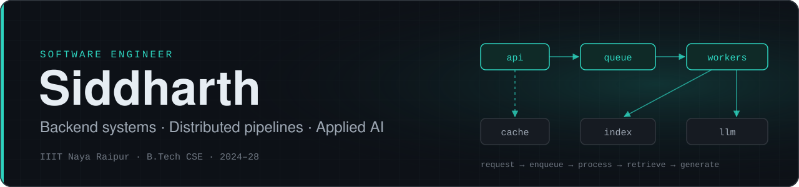

<!--
  Profile README for Siddharthpandey20.
  Header art lives in assets/ (dark and light variants).
  Live widgets: github-stats-extended (top languages), streak-stats.demolab.com, leetcard.jacoblin.cool.
  The old github-readme-stats.vercel.app instance is paused (HTTP 503), and the activity-graph and trophy
  instances return HTTP 402, so they were replaced or removed.
-->

<p align="center">
  <picture>
    <source media="(prefers-color-scheme: dark)" srcset="assets/header-dark.svg">
    <source media="(prefers-color-scheme: light)" srcset="assets/header-light.svg">
    
  </picture>
</p>

<p align="center">
  <a href="https://www.linkedin.com/in/siddharth-a35a36324"></a>
  <a href="mailto:siddharthpandey2611official@gmail.com"></a>
  <a href="https://leetcode.com/u/_Siddharth_pandey/"></a>
</p>

I build backend systems: task pipelines, multi-tenant APIs, access control, and the retrieval and LLM
layers that sit on top of them. I care about the parts that make software hold up: retries,
rate limits, isolation, tests, and numbers that come from a benchmark rather than a guess.

I'm a CS undergraduate at IIIT Naya Raipur, currently at **Hiring Bazaar** working on a production
AI interview platform. Alongside engineering I do research. I'm first author on two papers
(constraint-based floor-plan generation and reinforcement-learning traffic control), and I'm working
on recovery for compromised multi-agent LLM systems.

<div align="center">

| **82** | **2** | **2** | **9.74** |
|:---:|:---:|:---:|:---:|
| PRs merged in production | First-author papers accepted | Hackathon podiums (300+ & 500+ teams) | CGPA / 10 |

</div>

```python
siddharth = {
    "role"      : "Software Engineer · backend systems & applied AI",
    "now"       : "AI Engineering Intern @ Hiring Bazaar",
    "school"    : "IIIT Naya Raipur · B.Tech CSE · 2024–28",
    "focus"     : ["distributed backends", "API design", "retrieval (RAG)", "agentic systems"],
    "research"  : ["constraint optimisation", "multi-agent RL", "LLM security"],
    "principle" : "Explain the why, not just the what.",
    "open_to"   : "SDE · Backend · AI Engineering roles",
}
```

---

## What I work on

- **Backend and distributed systems.** Celery and BullMQ task pipelines, Redis rate limiting and
  distributed locking, multi-tenant REST APIs, role-based access control, async PostgreSQL, schema migrations.
- **AI engineering.** Hybrid retrieval (BM25 + dense + RRF), multi-provider LLM routing with fallback,
  tool-calling agents, and multi-agent workflows where a human keeps the final decision.
- **Engineering practice.** Claims backed by evaluation sets and benchmarks, real test suites
  (193 tests in ExamPrep AI, 325 in Prove It, 600+ in CausalLine), CI, and explicit fallbacks for every external dependency.

---

## 💼 Experience

<table>
<tr>
<td valign="top">

### 🤖 Hiring Bazaar — AI Engineering Intern
**Mar 2026 – Present** · Remote

- **82 pull requests merged** into the platform's production codebase (private GitHub organization)
- Shipped a **voice recruiter copilot** (STT/TTS + LLM intent parsing) over 1,000+ profiles → manual screening **−60%**
- Restructured async interview pipelines (**BullMQ + TypeScript**) → response latency **−40%**
- Token-usage guardrails + prompt caching → LLM API cost **−30%**
- Built LLM-orchestration microservices in **FastAPI** + **Express.js**, with **Judge0** for live code evaluation

</td>
</tr>
</table>

---

## Featured Projects

### 01 · [ExamPrep AI](https://github.com/Siddharthpandey20/ExamAI)

<sub><b>SOLO BUILD</b> &nbsp;·&nbsp; <a href="https://github.com/Siddharthpandey20/ExamAI">Repository</a> &nbsp;·&nbsp; <a href="https://drive.google.com/file/d/1kkcz9UO09Gd5X8TbkhLUN-eS8pxmH_om/view?usp=sharing">Demo Video</a></sub>

Upload a course's slides and past exam papers once. The backend extracts, structures and indexes every
slide, ranks what matters for the exam, and answers questions from your own material with slide-level citations.

- **Distributed ingestion.** Celery task chains (ingest → structure → index) on Redis with late
  acknowledgement, exponential-backoff retries for transient errors only, and stale-job detection.
  Progress streams to the browser over SSE. The API layer is 30+ FastAPI endpoints.
- **Shared-resource control.** A Redis sliding-window rate limiter and a Lua-scripted distributed
  semaphore coordinate LLM calls across workers, with automatic model fallback on HTTP 429.
  SQLite in WAL mode sustains 91 transactions/s across 8 concurrent writers with zero lock failures.
- **Retrieval.** BM25 and dense search (ChromaDB, e5-large-v2) fused with reciprocal rank fusion:
  Recall@5 **0.816** on a 114-question benchmark (0.754 dense-only), ~95 ms median latency.
- **AI layer.** Multi-LLM routing across local Ollama, Gemini and Groq, plus a tool-calling agent
  (OpenAI Agents SDK, 9 function tools). 193 offline pytest tests; Next.js 15 frontend.


### 02 · [CausalLine](https://github.com/Siddharthpandey20/CausalLine)

<sub><b>RESEARCH PROTOTYPE · IN PROGRESS</b> &nbsp;·&nbsp; Lead developer, 3-person team &nbsp;·&nbsp; <a href="https://github.com/Siddharthpandey20/CausalLine">Repository</a></sub>

Selective recovery for multi-agent LLM systems after prompt injection. Once a detector names a poisoned
source, CausalLine decides which completed work has to be recomputed and which can safely be kept,
instead of discarding everything downstream of the compromised agent.

- **Core idea: exposure is not influence.** It records an append-only provenance trace, establishes
  per-pair influence from agent self-report plus counterfactual replay, and spreads contamination only
  along evidenced influence edges rather than call-graph reachability.
- **Recovery engine.** A cost-minimising recovery plan, byte-exact selective replay of the affected
  events, and verification before a recovered run is accepted. It escalates to an agent restart and then to a full restart when verification fails.
- **Evaluation.** Run on a 56-agent, 145-event workflow across 3 inference providers and 15 attack placements, with
  **zero unsafe preservations**. It keeps 7.0 and 15.2 points more correct work than topology-closure recovery in the
  medium and large contamination regimes, loses 17.4 in the small one, and costs more tokens, a trade-off the write-up reports.
- **Engineering.** Python 3.11 with no third-party dependencies in the core, and 600+ unit tests.
- **My part (53 of 73 commits).** I designed and built the original system: the trace layer, the influence estimator,
  the Safe Frontier recovery planner, and splice-and-verify replay. I then led the evaluation. That covered the 56-agent,
  three-provider testbed behind the results above, the safety fix those results rest on, local-GPU and token-cost
  studies, and the paper draft.


### 03 · [Study AI](https://github.com/Siddharthpandey20/Study_AI_Complete_Project)

<sub><b>3RD PLACE · APIHUB HACKATHON 2025 (500+ TEAMS)</b> &nbsp;·&nbsp; 3-person team &nbsp;·&nbsp; <a href="https://github.com/Siddharthpandey20/Study_AI_Complete_Project">Repository</a> &nbsp;·&nbsp; <a href="https://drive.google.com/file/d/1bq5EJROvsifbRsGJLoaQP4rgihgUSnEp/view?usp=sharing">Demo Video</a></sub>

A study platform that turns uploaded notes into flashcards, quizzes, mind maps, learning paths,
revision notes and likely exam questions. It also answers questions about a document and lets study groups share both.

- **Backend.** An async FastAPI service with 50+ endpoints over a 7-table SQLAlchemy schema. It handles
  Google OAuth 2.0 sign-in with a signed JWT session cookie, and stores files in Cloudinary with a signed-download fallback.
- **Six generators from one upload.** Each prompt returns a fixed JSON shape that the frontend renders
  directly, and results are persisted per document so they are reused rather than regenerated.
  Rule-based fallbacks keep the app working when the model is unavailable.
- **Document Q&A.** Hybrid FAISS + BM25 retrieval with query rewriting that always searches the
  original question first. Answers are grounded in the document, and the model declines questions the document doesn't cover.
- **Study groups and YouTube.** Groups share documents and generated material via an invite key.
  YouTube transcripts are summarised into study guides, with a yt-dlp + Whisper fallback.


### 04 · [Prove It](https://github.com/Siddharthpandey20/Prove_It-Code_decides-Agents_argue_and_Humans_rule)

<sub><b>FLIP THE SWITCH HACKATHON</b> &nbsp;·&nbsp; 4-person team &nbsp;·&nbsp; <a href="https://github.com/Siddharthpandey20/Prove_It-Code_decides-Agents_argue_and_Humans_rule">Repository</a> &nbsp;·&nbsp; <a href="https://youtu.be/wQ_h16DFlXc">Demo Video</a></sub>

*Code decides, agents argue, humans rule.* AI-written vulnerability reports take seconds to produce and an
hour to check. Prove It makes each report prove itself in a sandbox before a maintainer reads it.

- **Code decides.** The reporter submits a data-only proof, which runs in a Docker sandbox with no network,
  no secrets, non-root, a read-only filesystem and capped memory and processes. A parent-process harness classifies the outcome, and the result
  line is tagged with a one-time code the child process never sees. Eight forgery attempts are tested against it.
- **Agents argue.** An intake agent owns the ticket state machine, a Reproducer (Claude Code) runs the
  sandbox, and a Skeptic (OpenAI Codex) reviews the evidence and can dispute it. Reporter prose never
  reaches the agents, and a canary test enforces that.
- **Humans rule.** Only maintainers can escalate, close or override. Every move is enforced by one
  transition table with 73 tested cases.
- **Results.** It reproduced two real CVEs (PyYAML CVE-2020-14343, sqlparse CVE-2023-30608) on vulnerable
  builds and cleared them on patched ones, with 18/18 consistent sandbox runs and 325 tests green in CI on Linux and Windows.
- **My part.** The data-only proof format and out-of-process harness, the enforced state machine,
  per-agent lockdown, and the CI pipeline.


### 05 · [Lumen](https://github.com/Siddharthpandey20/Lumen-Financial-Advisor)

<sub><b>2ND PLACE (NATIONAL) · HACK-A-SOL 2025 (300+ TEAMS)</b> &nbsp;·&nbsp; <a href="https://github.com/Siddharthpandey20/Lumen-Financial-Advisor">Repository</a></sub>

A personal and small-business finance tracker. It reads receipts with an LLM, categorises every transaction,
and answers questions about spending through retrieval over the user's own records.

- **Ingestion pipeline.** Receipts and invoices go through OCR (Tesseract or Gemini vision), then structured parsing
  with a regex fallback, then categorisation with a confidence and reason. A Gmail API monitor and n8n webhook endpoints feed transactions in automatically.
- **Isolation by design.** Each user gets a separate FAISS index, so a query can never retrieve another
  user's data. JWT auth covers separate consumer and business profiles (GSTIN, invoice fields).
- **Tamper-evident audit.** Audit records live in a separate PostgreSQL database, and each one stores the
  SHA-256 hash of the previous record.
- **Stack.** FastAPI backend and React + TypeScript (Vite) frontend, with lazy model loading to keep API start-up fast.


---

## More Projects

| Project | What it shows |
|:--|:--|
| **[Finance Access-Control Backend](https://github.com/Siddharthpandey20/Finance-Data-Processing-and-Access-Control-Backend)**<br><sub>FastAPI · asyncpg · SQLAlchemy 2.0 · Alembic</sub> | An async fintech API. RBAC is enforced at both the route and query level (Viewer / Analyst / Admin), money is stored as `Decimal` rather than float, primary keys are UUIDs, and soft deletes preserve the audit trail. |
| **[MP-WMS: Maintenance & Workforce Management](https://github.com/Siddharthpandey20/CSPGCL-WorkManagement-Software)**<br><sub>FastAPI · React + TypeScript · JWT · pytest · Vitest</sub> | A role-based enterprise portal for power-plant maintenance planning. It has a six-level role hierarchy, a work-order state machine, leave approvals and an audit log, and keeps all business rules in the backend. |
| **[Air-Quality Forecasting](https://github.com/Siddharthpandey20/Air_Quality_Forecasting)**<br><sub>XGBoost · LightGBM · RidgeCV stacking</sub> | Multi-pollutant forecasting on CPCB sensor data, reaching PM2.5 R² **0.883**. It is benchmarked against published results (+3.9 to +10.4%) and includes an LSTM baseline to show why tree ensembles win on this data. |

---

## Research & Publications

**2D Floor Plan Generation via Constraint Satisfaction Problem Modeling**<br>
<sub><b>Accepted · MMCITRE 2025 · Springer LNNS Vol. 2101 (forthcoming)</b> &nbsp;·&nbsp; First author &nbsp;·&nbsp; <a href="https://github.com/Siddharthpandey20/Floor_Plan_Generator">Code</a></sub><br>
Formulates floor planning as a CSP on Google OR-Tools CP-SAT, covering area, boundary, non-overlap and weighted adjacency.
It needs no training data and produces deterministic, interpretable layouts. In evaluation it reached 100% hard-constraint satisfaction and
85.82% space utilisation, with average solve times under 8 s.

**Comparative Performance Evaluation of Fixed-Time and Hierarchical Traffic Signal Control Using Real-World Urban Traffic Data**<br>
<sub><b>Accepted · NCA 2026 workshop, Italy (not yet published)</b> &nbsp;·&nbsp; First author &nbsp;·&nbsp; <a href="https://github.com/Siddharthpandey20/Hierarchical-Cooperative-Multi-Agent-RL-for-Secure-Intelligent-Transportation-Systems-">Code</a></sub><br>
A survey of traffic-signal control with a Double-DQN case study in SUMO on real SCATS rush-hour data (Melbourne).
Adaptive control cut average waiting time by over 94% versus fixed-time plans, and cooperative multi-agent control
improved network throughput by 15%. The code also includes an LSTM layer that screens sensor data for false-data-injection attacks.

**CausalLine: Influence-Aware Selective Recovery After Prompt Injection in Multi-Agent LLM Systems**<br>
<sub><b>Ongoing research · paper in preparation</b> &nbsp;·&nbsp; First author, lead developer &nbsp;·&nbsp; <a href="https://github.com/Siddharthpandey20/CausalLine">Code</a></sub><br>
Asks what to recompute after a multi-agent system is found to have consumed poisoned input. The approach is
provenance tracing with counterfactual influence attribution and verified selective replay
(details under Featured Projects, 02).

---

## Tech Stack

<table>
<tr>
<td><b>Languages</b></td>
<td>


</td>
</tr>
<tr>
<td><b>Backend & APIs</b></td>
<td>


</td>
</tr>
<tr>
<td><b>Data & Messaging</b></td>
<td>


</td>
</tr>
<tr>
<td><b>AI & LLM Engineering</b></td>
<td>


</td>
</tr>
<tr>
<td><b>ML & Optimisation</b></td>
<td>


</td>
</tr>
<tr>
<td><b>Frontend</b></td>
<td>


</td>
</tr>
<tr>
<td><b>DevOps & Tooling</b></td>
<td>


</td>
</tr>
</table>

---

## Leadership & Achievements

- **Head, AI/ML Club**, IIIT Naya Raipur (2025–26). I organised the AI Impact Summit 2026, Chhattisgarh, with 500+ participants.
- **2nd Place (National)**, Hack-A-Sol 2025, 300+ teams, with [Lumen](https://github.com/Siddharthpandey20/Lumen-Financial-Advisor).
- **3rd Place**, APIHub Hackathon 2025, 500+ teams, with [Study AI](https://github.com/Siddharthpandey20/Study_AI_Complete_Project).
- **National Select**, AlgoUniversity Tech Fellowship 2025 (Top 1000).
- **550+ DSA problems** solved in C++ on LeetCode and GeeksforGeeks.

## Education

**B.Tech, Computer Science & Engineering**, IIIT Naya Raipur · 2024 – 2028 · **CGPA 9.74 / 10**<br>
<sub>Coursework: Data Structures & Algorithms, OOP, Operating Systems, DBMS, Computer Networks, Distributed Systems, System Design · WBJEE All India Rank 536</sub><br>
<sub>Certifications: Agentic AI Engineering (Ed Donner) · FastAPI: The Complete Course (Eric Roby & Chad Darby) · The Complete Web Development Bootcamp (Angela Yu)</sub>

---

## GitHub & Problem Solving

<p align="center">
  
  
</p>

<p align="center">
  <a href="https://leetcode.com/u/_Siddharth_pandey/"></a>
</p>

---

<p align="center">
  <b>Open to SDE, backend and AI engineering roles.</b><br>
  <sub>
    <a href="https://www.linkedin.com/in/siddharth-a35a36324">LinkedIn</a> &nbsp;·&nbsp;
    <a href="mailto:siddharthpandey2611official@gmail.com">Email</a> &nbsp;·&nbsp;
    <a href="https://leetcode.com/u/_Siddharth_pandey/">LeetCode</a>
  </sub>
</p>
